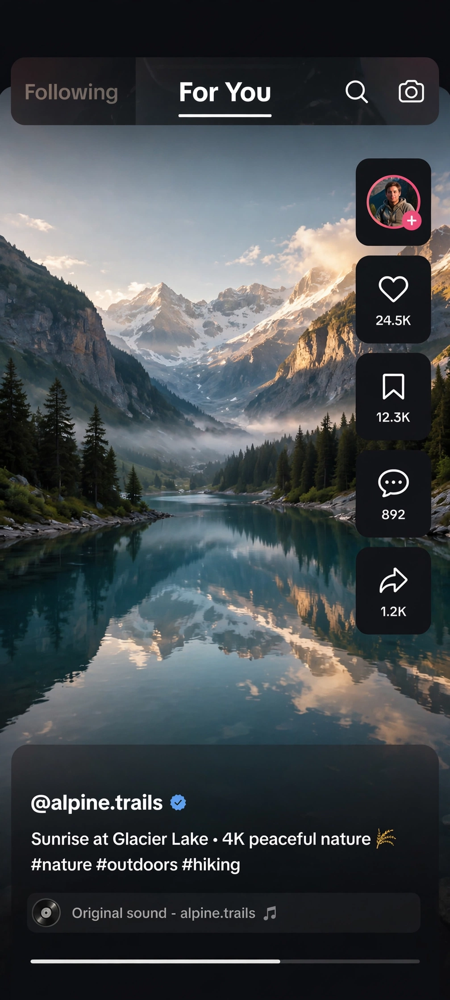

# Open Video

纯原生 Android 短视频 App（Kotlin + Compose）：上下滑动刷视频，点赞、收藏、观看历史全存在手机本地，不碰服务器。



## 特性

- TikTok 式上下滑信息流，拖动/缩放播放不中断
- 点赞、收藏、历史记录走本地存储，零后端依赖
- ExoPlayer 播放 + 本地磁盘缓存，重复看不耗流量
- 深色 UI

## 快速开始

```bash
# app/build.gradle.kts 里填你的视频服务器地址和密码
./gradlew assembleDebug
```

视频列表接口：`GET /api/videos` 返回 JSON 数组，字段见 `app/src/main/java/` 下的 model。

## 配置

`app/build.gradle.kts`：

```kotlin
buildConfigField("String", "PD_SERVER", "\"https://your-video-server.example.com\"")
buildConfigField("String", "PD_PASSWORD", "\"\"")  // 无密码留空
```

注意：配置会 baked 进 APK，公开仓库里只放占位符。

MIT License.
